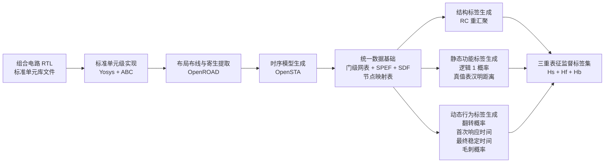

```
① RTL组合电路 + 标准单元库文件准备
   ↓ Python检查输入文件和单元名称的一致性

② RTL解析、组合电路检查和逻辑综合
   ↓ Yosys

③ 标准单元技术映射
   ↓ Yosys调用ABC

④ 标准单元级门级网表
   ↓ OpenROAD布局布线和寄生参数提取

⑤ 布局布线后门级网表 + DEF + SPEF
   ↓ OpenSTA读取Liberty、SPEF和时序约束

⑥ SDF延迟文件
   ↓ Python解析门级网表并建立统一节点编号

⑦ 标准单元级/引脚级电路图 + 节点映射表
   ├──────────────────────────────────────────┐
   │                                          │
   ├─ 结构标签支路                            │
   │  ↓ Python执行重汇聚关系分析              │
   │  RC节点对 + RC二分类标签                 │
   │                                          │
   ├─ 静态功能标签支路                        │
   │  ↓ Python生成稳定输入向量                │
   │  ↓ Icarus Verilog零延迟门级仿真          │
   │  节点响应向量/不完整真值表               │
   │  ↓ Python统计                            │
   │  节点逻辑1概率                           │
   │  ↓ Python构造节点对并计算归一化汉明距离  │
   │  真值表汉明距离标签                      │
   │                                          │
   └─ 动态行为标签支路                        │
      ↓ Python生成独立输入转换对 a→b          │
      ↓ Icarus Verilog零延迟仿真              │
      转换前、转换后的节点稳态逻辑值          │
      ↓ Icarus Verilog反标SDF时序仿真         │
      节点时序波形                            │
      ↓ Python解析波形并按节点统计             │
      翻转概率 + 首次响应时间                  │
      + 最终稳定时间 + 毛刺概率                │
                                              │
   └──────────────────────────────────────────┘
                     ↓
⑧ 按统一节点编号合并标签
                     ↓
⑨ Hs、Hf、Hb三重表征训练标签集
```

## 每一步具体使用什么、做什么、得到什么

| 步骤                      | 输入                                                                  | 使用工具                      | 做什么                                                                                | 输出                                        |
| ------------------------- | --------------------------------------------------------------------- | ----------------------------- | ------------------------------------------------------------------------------------- | ------------------------------------------- |
| 1. 准备设计与标准单元库   | 组合电路 RTL                                                          | 人工整理 + Python 检查脚本    | 确认顶层模块、输入输出端口以及 RTL 可综合性                                           | 通过初步检查的 RTL                          |
| 2. 准备标准单元库         | Liberty、technology LEF、cell LEF、标准单元 Verilog 模型、RC 技术文件 | Python 检查脚本               | 检查各文件中的标准单元名称和端口名称是否一致                                          | 完整且匹配的标准单元库配置                  |
| 3. RTL 解析与组合电路检查 | RTL                                                                   | Yosys                         | 展开层次、解析 RTL，检查锁存器、触发器、组合环和多驱动等问题                          | 规范化的组合逻辑设计                        |
| 4. 逻辑综合               | 规范化 RTL                                                            | Yosys                         | 执行逻辑优化，将 RTL 转换为门级逻辑网络                                               | 综合后的中间网表                            |
| 5. 标准单元技术映射       | 中间网表、Liberty                                                     | Yosys 调用 ABC                | 将逻辑门映射为指定标准单元库中的门                                                    | 标准单元级网表 `mapped.v`                   |
| 6. 逻辑一致性检查         | 原始 RTL、`mapped.v`                                                  | Yosys                         | 检查技术映射前后组合逻辑功能是否一致                                                  | 通过等价性检查的门级网表                    |
| 7. 生成物理设计约束       | 顶层端口、工艺信息、设计约束                                          | Python                        | 生成 OpenROAD 配置和 SDC 约束文件                                                     | OpenROAD 配置文件、`design.sdc`             |
| 8. 布局布线               | `mapped.v`、LEF、Liberty、SDC                                         | OpenROAD                      | 完成标准单元放置、时钟无关的组合电路布线以及物理优化                                  | 布局布线后的门级网表 `final.v`、`final.def` |
| 9. 寄生参数提取           | 布局布线结果、RC 技术文件                                             | OpenROAD                      | 提取线网电阻和电容                                                                    | `final.spef`                                |
| 10. 生成时序延迟文件      | `final.v`、`final.spef`、Liberty、SDC                                 | OpenSTA                       | 计算标准单元延迟和线网延迟，导出可反标仿真的延迟                                      | `final.sdf`                                 |
| 11. 建立统一节点映射      | `final.v`                                                             | Python 网表解析程序           | 提取标准单元、引脚、线网和连接关系，为所有标签建立统一节点编号                        | 电路图、`node_mapping`                      |
| 12. 生成 RC 标签          | 电路图及连接关系                                                      | Python 图分析程序             | 分析节点之间是否存在共同前驱及分支后重新汇聚关系                                      | `rc_pair_index`、`is_rc`                    |
| 13. 生成稳定输入向量      | 主输入数量、仿真样本数 \(N\)                                          | Python                        | 生成 DeepGate2 式随机稳定输入向量，建议保持其默认的 \(N=15000\)                       | 稳定输入测试集                              |
| 14. 获取节点功能响应      | 稳定输入测试集、`final.v`、标准单元功能模型                           | Icarus Verilog 零延迟门级仿真 | 对所有稳定输入进行逻辑仿真，记录每个节点的稳态输出                                    | 节点响应向量 \(T_v\)，即不完整真值表        |
| 15. 计算逻辑 1 概率       | 节点响应向量 \(T_v\)                                                  | Python                        | 统计节点输出为 1 的样本比例                                                           | 节点逻辑 1 概率 `prob`                      |
| 16. 计算真值表汉明距离    | 节点响应向量、节点候选对                                              | Python                        | 按 DeepGate2 的节点对筛选条件构造节点对，并计算归一化汉明距离                         | `tt_pair_index`、`tt_dis`                   |
| 17. 生成输入转换对        | 主输入数量、转换样本数 \(M\)、固定输入转换分布                        | Python                        | 为每个样本生成转换前输入 \(a_k\) 和转换后输入 \(b_k\)                                 | 输入转换测试集 \(\{a_k\rightarrow b_k\}\)   |
| 18. 获取转换前后稳态值    | 输入转换测试集、`final.v`、标准单元功能模型                           | Icarus Verilog 零延迟仿真     | 分别获取每个节点在 \(a_k\) 和 \(b_k\) 下的稳态逻辑值                                  | \(y_v(a_k)\)、\(y_v(b_k)\)                  |
| 19. 获取节点时序波形      | 输入转换测试集、`final.v`、`final.sdf`、标准单元时序模型              | Icarus Verilog SDF 反标仿真   | 先施加 \(a_k\) 并等待稳定，再在 \(t_{\text{apply}}\) 切换为 \(b_k\)，记录节点事件波形 | 每个节点每个转换样本的时序波形              |
| 20. 提取单样本行为事件    | 节点时序波形、转换前后稳态值                                          | Python 波形解析程序           | 判断节点是否翻转，提取第一次响应时刻、最终稳定时刻，并判断是否发生毛刺                | 节点逐样本行为记录                          |
| 21. 聚合动态行为标签      | 全部逐样本行为记录                                                    | Python                        | 在固定输入转换分布下，对每个节点进行概率和时间统计                                    | `tp`、`d_first`、`d_stable`、`glitch_prob`  |
| 22. 合并三重表征标签      | 全部标签、`node_mapping`                                              | Python                        | 将节点标签和节点对标签映射到统一图节点编号                                            | \(H_s\)、\(H_f\)、\(H_b\) 的完整监督数据    |

## 
